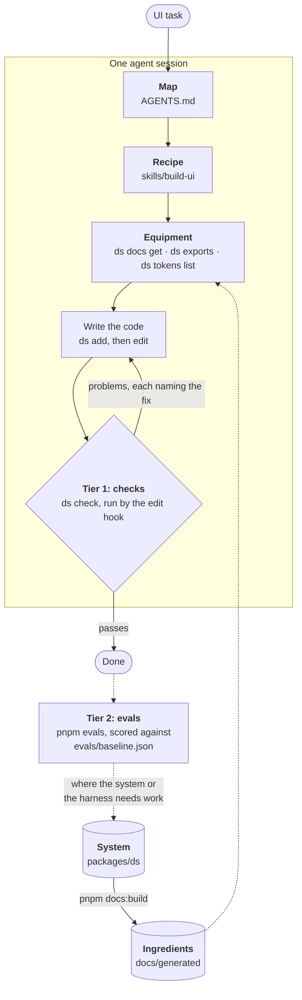

# The harness

The design system provides the *what*: components, tokens and the rules for
using them. The harness provides the *how*: it delivers that knowledge to the
agent, constrains its choices and verifies its output.

| Piece | Role | In this repo |
| --- | --- | --- |
| System | What good UI is made of | `packages/ds/`: components, prop types, tokens, `*.docs.md` with rule IDs |
| Map | What exists, where it is, how to proceed | `AGENTS.md`, `docs/generated/llms.txt` |
| Recipes | Step-by-step workflows | `skills/build-ui/`, `skills/review-ui/` |
| Ingredients | System data, loaded on demand | `docs/generated/`, compiled from the system by `scripts/build-docs.ts` |
| Equipment | How the agent reaches the system, and how checks run unasked | `cli/` (`ds`), `mcp/server.ts`, `.claude/settings.json` → `cli/hook.ts` |
| Tier 1: checks | Catch mechanical errors in the session | `checks/`: `tsc`, lint rules, audits, `--visual` render and accessibility |
| Tier 2: evals | Measure consistency and judgment over time | `evals/`: tasks with intent checks, runs, a team baseline |

The harness works through two mechanisms.

## Progressive disclosure

Each layer is small and points to the next, so the agent loads only what the
task needs.

| Layer | Loaded | Size |
| --- | --- | --- |
| `AGENTS.md` | Every session | 56 lines: four rules, the commands, which skill to read |
| `skills/<task>/SKILL.md` | When the task matches | 40 to 60 lines: rules and the workflow |
| `skills/build-ui/references/*.md` | Only the row the routing table names | 40 to 100 lines each |
| `ds docs get <Component>`, `ds tokens list`, `ds docs search` | Just before the agent uses a component or token | One component, about 50 lines |
| A `ds check` message | After the agent writes code | One problem, the fix, and the command to read next |

All the component docs together, `docs/generated/llms-components.txt`, are 353
lines. A login form needs three of them: Button, Stack and TextField.

## Guardrails

| Guardrail | Enforced by | Source |
| --- | --- | --- |
| Only real exports | `ds/no-unknown-imports`, with a named replacement for each known hallucination | `checks/rules/no-unknown-imports.ts`, `ds.config.ts` |
| Only real props | `tsc`. Guessed props fail the type check. | Prop types in `packages/ds/` |
| Token-only styling | `ds/no-raw-values` in `style`, `className` and CSS files | `checks/rules/no-raw-values.ts`, `checks/css-raw-values.ts` |
| One layout primitive | `ds/prefer-stack` | `checks/rules/prefer-stack.ts` |
| Component rules | `audit/textfield-label`, `audit/one-primary-button`, each citing its rule ID | `checks/audit/` |
| Accessibility | `a11y/<axe rule>` on the rendered page | `checks/visual.ts` |
| No way around them | Inline `eslint-disable` comments are ignored | `checks/lint.ts` |
| Checks run unasked | The edit hook runs `ds check` on every file the agent writes | `.claude/settings.json`, `cli/hook.ts` |
