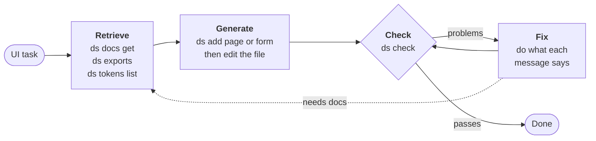

# The loop

An agent is only as reliable as the context it retrieves and the checks it cannot skip.

| Step | Command | Source of truth |
| --- | --- | --- |
| Retrieve | `ds docs get <Component>`, `ds docs search <query>`, `ds exports`, `ds tokens list` | `docs/generated/`, compiled from TSDoc, `*.docs.md`, examples and `tokens.ts` |
| Generate | `ds add page <name>`, `ds add form <name>` | `cli/templates/`, real type-checked files |
| Check | `ds check [path]` | `tsc`, `lint/rules/`, `lint/audit/`. Deterministic, no LLM. |
| Fix | Follow the message, then run `ds check` again | Every message names the replacement and the command to read next |
